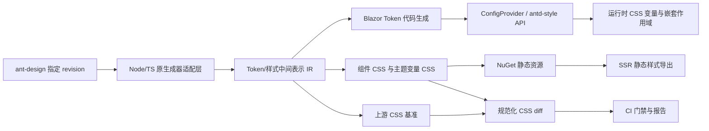
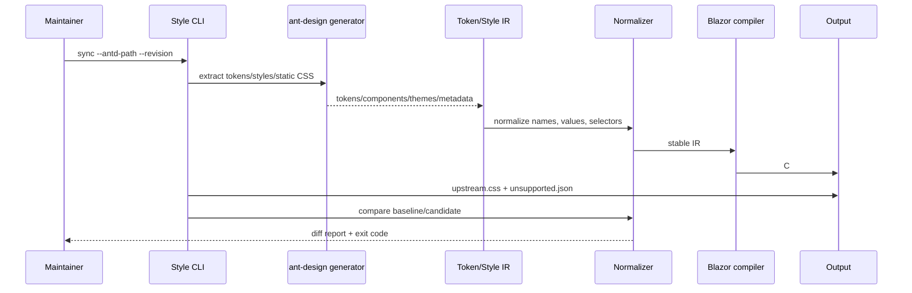

# Ant Design v6 CSS 变量主题迁移设计

## Overview

本设计为 `ant-design-blazor` 建立一套以 Ant Design v6 为基准、以 CSS Variables 为运行时主题载体、以 `antd-style` 为主题对象和样式消费参考的样式系统。

设计目标：

- 从指定的 `ant-design` revision 提取 Token 和组件样式输入，并尽可能调用原有 TypeScript/Node 生成器。
- 生成 Blazor 可消费的 Token 元数据、CSS Variables、组件 CSS、主题 CSS 和 SSR 静态样式。
- 提供 Blazor 版 `antd-style` 核心能力：主题对象、Token 上下文、`cssVar`、样式工厂、class 合并和确定性缓存。
- 将现有 `ConfigProvider` 的主题入口升级为接近 Ant Design `ConfigProvider.theme` 的 API，同时保持现有组件公共 API。
- 通过上游 CSS 基准与 Blazor CSS 的规范化差异校验实现 1:1 迁移门禁。
- 在核心组件样式完成后实现 Semantic DOM 文档展示和首页 13 个主题的演示。

关键取舍：组件 CSS 与主题变量分离。组件 CSS 尽可能只生成一次，主题只负责作用域内的变量值；预构建主题通过 class/data 属性切换，动态 Token 通过受控的运行时变量覆盖。这样兼顾体积、切换性能和嵌套主题隔离。

CSS 一致性是硬门禁：固定上游 revision 下，React/Ant Design 原生成器编译出的 CSS 字符串先作为不可手工修改的基准快照保存；Blazor 编译器必须对同一输入生成完全一致的 CSS 字符串。结构化 diff 只用于定位差异，不能用格式容差替代最终的字节级相等校验。

CSS 构建必须明确分离两类产物：

- **静态组件样式层**：生成稳定的 class name、selector、DOM 状态规则、variant、伪类、at-rule 以及对 `var(--ant-...)` 的引用。它与具体主题值无关，原则上只生成一份并可跨主题复用。
- **Design Token 变量值层**：由 Seed/Alias/Component/Semantic Token 和主题算法生成 `--ant-*` 的实际值，按 `theme + scope + component` 组织，可在构建时导出、SSR 注入或运行时切换。

两层必须拥有不同的 manifest 类型、digest、缓存键和测试 fixture。静态层的变化表示组件结构/样式生成逻辑变化；变量值层的变化表示 Token、算法或主题配置变化。完整 CSS 只在发布打包阶段按固定顺序拼接两层。

## Architecture

### 总体流程



### 分层

1. **上游采集层**：定位源码 revision，运行原生成器或读取其导出结果，收集 Token、组件样式、语义元数据和主题演示配置。
2. **中间表示层（IR）**：将 JS/TS 值转换为稳定的 JSON schema，保留来源路径、Token 类型、组件、选择器、at-rule、fallback 和未支持字段。
3. **编译层**：由 Node 侧负责最接近上游的 CSS 生成；由 .NET 侧生成强类型 Token、主题对象和 SSR 资源索引。两侧使用同一份 IR 和规范化规则。
4. **运行时层**：提供 Token 上下文、作用域管理、CSS 变量写入、嵌套主题合并和样式 class 缓存。
5. **文档/验证层**：提供 Semantic DOM 与 13 主题展示，并运行 CSS diff、组件渲染、SSR 和可访问性测试。

### 原生成器策略

优先采用 Node 子进程调用方式，而不是复制 Ant Design 的全部 JS 算法：

- CLI 接收 `--antd-path`、`--revision`、`--out`、`--theme` 和 `--components`。
- Node 入口负责调用上游 Token 元数据、Token 统计、组件 style generator 和 static-style-extract 能力。
- 输出 `manifest.json`、`tokens.json`、`components.json`、`themes.json`、`upstream.css` 和 `unsupported.json`。
- .NET 项目只依赖稳定 IR，不直接引用 Node 模块。
- 当上游包 API 变化时，适配层失败并报告版本/字段差异，不偷偷使用旧规则。
- 若某项无法由原生成器导出，则增加明确的适配器，并把该差异加入报告和测试 fixture。

## Design Token 迁移示例

### 上游输入

以当前 `ant-design` 的 `SeedToken` 和 Button Component Token 为例，原生成器读取类似以下定义：

```ts
// ant-design/components/theme/themes/seed.ts
const seedToken = {
  colorPrimary: '#1677ff',
  borderRadius: 6,
  controlHeight: 32,
};

// ant-design/components/button/style/token.ts
export interface ComponentToken {
  contentFontSize: number;
  defaultBorderColor: string;
  defaultHoverColor: string;
  primaryShadow: string;
}
```

上游样式生成器中的组件样式使用解析后的 Token，而不是直接依赖业务传入的 Seed Token：

```ts
const buttonToken = {
  colorPrimary: token.colorPrimary,
  colorPrimaryHover: token.colorPrimaryHover,
  borderRadius: token.borderRadius,
  ...componentToken,
};
```

CLI 将其转换为 IR，并保留来源与计算关系：

```json
{
  "name": "colorPrimary",
  "kind": "seed",
  "type": "color",
  "value": "#1677ff",
  "cssVariable": "--ant-color-primary",
  "source": "components/theme/themes/seed.ts"
}
```

### Blazor 侧生成结果

原始 Token 生成强类型入口，Component Token 允许按组件扩展：

```csharp
var theme = new ThemeConfig
{
    Algorithm = ThemeAlgorithm.Default,
    Token = new ThemeToken
    {
        ColorPrimary = "#1677ff",
        BorderRadius = 6,
        ControlHeight = 32
    },
    Components = new Dictionary<string, ComponentToken>
    {
        ["Button"] = new()
        {
            PrimaryShadow = "0 2px 0 rgba(5, 145, 255, 0.1)",
            DefaultBorderColor = "var(--ant-color-border)"
        }
    }
};
```

CSS 编译器输出稳定的变量和共享组件样式：

```css
:where(.ant-theme-app) {
  --ant-color-primary: #1677ff;
  --ant-color-primary-hover: #4096ff;
  --ant-border-radius: 6px;
  --ant-control-height: 32px;
  --ant-button-primary-shadow: 0 2px 0 rgba(5, 145, 255, 0.1);
}

:where(.ant-theme-app) .ant-btn {
  border-radius: var(--ant-border-radius);
  min-height: var(--ant-control-height);
}

:where(.ant-theme-app) .ant-btn-primary {
  background: var(--ant-color-primary);
  box-shadow: var(--ant-button-primary-shadow);
}
```

暗色主题不复制 Button 样式，只生成同一 scope 下的变量值：

```css
:where(.ant-theme-app[data-theme='dark']) {
  --ant-color-primary: #1668dc;
  --ant-color-primary-hover: #3c89e8;
}
```

### Token 迁移规则

1. 先导出上游 Seed Token 和 Token 类型元数据。
2. 执行与上游一致的 default/dark/compact 算法，生成 Alias/Semantic Token。
3. 对每个组件执行 `prepareComponentToken` 等上游映射，保留计算后的 Component Token。
4. 将 Token 名称转换为稳定 CSS Variable 名称，并记录旧 Less 名称（仅用于迁移报告，不提供旧主题兼容）。
5. 将组件 style generator 的 CSSObject/模板结果序列化为 CSS，并把可替换 Token 替换为 `var(...)`。
6. 输出 C# 类型、JSON manifest、CSS、source map 和未支持字段报告。

## CSS 构建流程与产物

### 开发/同步流程



### 构建阶段

1. **Resolve**：确认 Node、pnpm/npm、上游依赖和 revision；记录 lockfile 与 generator version。
2. **Extract**：调用原生成器或适配器导出 Token、组件样式、主题注册表和静态 CSS。
3. **Normalize**：统一颜色、长度、数字、空白、选择器、伪类、at-rule 和 CSS Variable 命名；保留顺序敏感信息。
4. **Compile React baseline**：先运行 Ant Design 原生成器，在固定输入、Node 版本、依赖 lockfile 和生成器版本下，为每个组件、主题、变体和所需 SSR 组件集合导出原始 CSS 字符串。原始字符串按 manifest 索引保存，不经过会改变内容的格式化。
5. **Compile static layer**：从 IR 生成静态组件 CSS，只包含稳定 class/selector 和 CSS Variable 引用；分别保存 React static baseline 与 Blazor static candidate。
6. **Compile token-value layer**：从同一份 Token IR 和主题配置生成变量定义块；分别保存 React variable baseline 与 Blazor variable candidate，支持主题和 scope 维度。
7. **Compile Blazor package**：按 manifest 规定的 `static layer -> token-value layer -> runtime override layer` 顺序拼接；C# 序列化器必须采用与 React 侧一致的规则，包括规则顺序、声明顺序、数字/颜色格式、空格、换行、转义、CSS Variable 名称和 at-rule 位置。
8. **Exact validate**：先分别对静态层和变量值层执行 UTF-8 字节级完全相等比较，再对固定顺序拼接后的完整 CSS 执行完全相等比较；任意组件或主题不一致即失败。随后可额外生成 AST/声明级 diff、JSON 和 Markdown 报告用于定位，但定位报告不能改变 exact gate 结果。
9. **Package**：只有各层和完整 CSS 的 exact 校验都通过，才将 CSS、manifest、Token 元数据和 SSR 资源纳入 `AntDesign` 静态资源；将 CLI、React 基准快照和生成元数据纳入源码管理。

### 生成产物布局

```text
artifacts/antd/<revision>/
  manifest.json
  tokens.json
  components.json
  themes.json
  react-baseline/
    manifest.json
    static/
      Button.default.css
      Button.dark.css
      ...
    token-values/
      light.css
      dark.css
      mui.css
      ...
  upstream.css
  blazor.css
  blazor.variables.css
  runtime-overrides.css
  ssr/
    light.css
    dark.css
    <theme>.css
  reports/
    exact-mismatch.json
    unsupported.json
    css-diff.json
    css-diff.md
```

生成的 C# 文件和 CSS 文件必须有 `// <auto-generated />` 或 CSS managed marker。构建默认不允许手工修改生成文件；修改应回到上游适配器、映射配置或自定义扩展层。

React 基准快照同样由 CLI 管理，必须带有 upstream revision、生成器版本、Node/runtime 版本、依赖 lockfile digest、输入 manifest digest 和 UTF-8 编码声明。基准快照只能通过显式的 `baseline update` 命令更新，并且该命令必须同时生成变更摘要；普通构建和测试不得自动覆盖基准。

### React 与 Blazor CSS 精确一致性测试

测试采用“静态层、变量值层分别比较 + 完整产物汇总比较”三级结构：

```text
for artifact in baseline.manifest.static:
    assert readUtf8(react-baseline/static/artifact.path)
        == compileBlazorStatic(artifact.input)

for artifact in baseline.manifest.tokenValues:
    assert readUtf8(react-baseline/token-values/artifact.path)
        == compileBlazorTokenValues(artifact.input)

assert readUtf8(react-baseline/full.css) == compileBlazorFullCss(baseline.manifest)
```

- **静态层组件级**：Button、Alert、Modal 等每个组件分别比较 class name、selector、状态和 `var(...)` 引用，避免总 CSS 相同但组件之间互相错位。
- **变量值层主题级**：默认、暗色和 13 个首页主题分别比较 Seed/Alias/Component/Semantic Token 编译出的变量值块。
- **场景级**：variant、状态、RTL、紧凑尺寸、弹层和 SSR 组件集合分别使用独立 manifest。
- **运行时层**：动态覆盖变量只比较变量赋值和 scope，不重新比较静态组件 CSS。
- **总体级**：按 `static -> token-values -> runtime-overrides` 顺序拼接后的完整 CSS 字符串再次执行字节级比较。
- **失败输出**：输出首个不同字节位置、行列、上下文片段、组件、主题、Token、来源文件和结构化 diff。
- **更新流程**：上游 revision 变化时先重新生成 React 基准并审查差异，再修改 Blazor 适配器；禁止为了通过测试而修改基准。

因此，测试不是比较“视觉上接近”或“归一化后等价”，而是分别验证 Blazor 是否复现 React 原生成器的静态组件 CSS 和 Design Token 变量值 CSS，再验证二者按协议拼接后的完整结果。若平台换行或编码导致差异，必须在生成协议中固定为 UTF-8、LF 和明确的末尾换行规则。

## 主题应用设计

### ConfigProvider 解析

主题应用分成“解析配置”和“应用变量”两步。`ConfigProvider` 首次渲染或参数改变时，通过 `IThemeResolver` 完成父子配置合并、算法派生和变量快照；通过 `IThemeApplier` 将快照写入当前 scope。

```csharp
<ConfigProvider Theme="@theme"
                ThemeScope="dashboard"
                Appearance="dark">
    <Button Type="primary">保存</Button>
</ConfigProvider>
```

对应 DOM 作用域：

```html
<div class="ant-theme-dashboard" data-theme="dark">
  <button class="ant-btn ant-btn-primary">保存</button>
</div>
```

应用规则：

1. 找到最近的父级主题上下文。
2. 合并 `ThemeConfig`，内层显式值覆盖外层值，未覆盖值继续继承。
3. 执行主题算法，得到完整 Resolved Token 和 Component Token。
4. 生成或取得 scope 对应的 CSS Variable 快照。
5. SSR 阶段输出静态变量；交互式客户端只更新 scope class/data 属性或变量值。
6. 仅在 Token 快照变化时通知订阅组件，避免因主题切换重建整个组件树。

### 三种主题模式

- **预构建主题**：在 CSS 中同时生成 `.light .scope`、`.dark .scope` 等变量块，切换外层属性即可完成无闪烁切换。
- **动态主题**：使用固定 scope 和已知变量名，通过 JS interop 或受控 DOM 操作修改变量值；不重新序列化组件 CSS。
- **嵌套主题**：为每个 `ConfigProvider` 分配显式或确定性 scope，变量只在 scope 内生效，组件共享同一份 CSS。

### antd-style 对应使用方式

组件和文档自定义样式通过 `IStyleFactory` 消费上下文：

```csharp
var styles = StyleFactory.Create(
    "semantic-card",
    StyleDefinition.Object(new
    {
        backgroundColor = context.CssVar.ColorBgContainer,
        borderRadius = context.CssVar.BorderRadiusLG,
        color = context.CssVar.ColorText
    }),
    context);

var className = StyleFactory.Cx("demo-card", styles.ClassName);
```

`CssVar` 返回 `var(--ant-...)` 引用，`Token` 返回解析后的当前值；两者均来自同一个 `IThemeContext`。SSR 使用相同的 `StyleDefinition` 生成静态 CSS，客户端只复用 class 和变量。

### 主题切换与 SSR

服务端根据请求中的主题 cookie、URL 或应用配置选择初始 `Appearance`，提前输出对应变量 CSS 和 scope。客户端启动时读取同一主题状态，比较 manifest digest；一致时不重新生成 CSS，只绑定切换事件。切换到预构建主题时只修改 `data-theme`；切换动态 Token 时批量调用 `style.setProperty`，并使用 request animation frame 合并更新。

## Components and Interfaces

### 1. 生成 CLI

建议提供 `tools/AntDesign.StyleGen`（Node/TypeScript）和 `tools/AntDesign.StyleDiff`（.NET global/local tool 或同一 CLI 的子命令）。命令接口：

```text
antdesign-style sync --antd-path <path> --revision <rev> --output <dir>
antdesign-style compile --manifest <file> --target blazor --output <dir>
antdesign-style diff --baseline <css> --candidate <css> --allowlist <json>
antdesign-style export-ssr --manifest <file> --theme <name> --components <list> --output <file>
```

CLI 必须支持 dry-run、详细日志、JSON 报告、非零退出码、生成摘要和 CI 无交互模式。

### 2. Blazor 版 antd-style

建议命名空间 `AntDesign.Theming`，核心类型如下：

```csharp
public sealed record ThemeConfig
{
    public ThemeAlgorithm Algorithm { get; init; } = ThemeAlgorithm.Default;
    public ThemeToken Token { get; init; } = ThemeToken.Empty;
    public IReadOnlyDictionary<string, ComponentToken> Components { get; init; }
        = ImmutableDictionary<string, ComponentToken>.Empty;
    public string? Scope { get; init; }
    public string? Appearance { get; init; }
}

public interface IThemeContext
{
    ThemeConfig Config { get; }
    ResolvedToken Token { get; }
    CssVarToken CssVar { get; }
    string ScopeClass { get; }
    string Appearance { get; }
}

public interface IStyleFactory
{
    StyleResult Create(string name, StyleDefinition definition, IThemeContext context);
    string Cx(params string?[] classNames);
}

public sealed record StyleResult(
    string ClassName,
    IReadOnlyDictionary<string, string> Styles,
    IReadOnlyList<string> GeneratedCss);
```

`StyleDefinition` 应支持对象式属性树、嵌套选择器、媒体查询、变量引用和显式原始 CSS；不支持的 CSS-in-JS 动态函数必须在编译期报告。生成 class 使用内容摘要和生成器版本确定，不能使用每次进程随机值。

### 3. ConfigProvider

保留现有 `AntDesign.ConfigProvider` 类型和组件用法，扩展其主题参数：

```razor
<ConfigProvider Theme="@Theme"
                ThemeScope="app-theme"
                Appearance="dark"
                EnableCssVariables="true">
    @ChildContent
</ConfigProvider>
```

建议新增或演进的公开能力：

- `Theme`：`ThemeConfig`，包含全局 Token、组件 Token、算法、嵌套主题和 scope。
- `Appearance`：`light`、`dark` 或自定义主题名。
- `ThemeScope`：稳定的 class/data scope，用于嵌套主题隔离和首屏注入。
- `EnableCssVariables`：默认启用，允许 SSR/静态导出明确控制。
- `SetThemeAsync`/等价服务调用：仅更新变量和主题状态，不强制重建组件树。

现有 `GlobalTheme` 和 Less 链接切换逻辑转为兼容外观入口或迁移层；核心实现不再以切换 CSS 文件为主。

### 4. SSR 静态样式导出

```csharp
public interface IStaticStyleExporter
{
    ValueTask<StaticStyleResult> ExportAsync(
        StaticStyleRequest request,
        CancellationToken cancellationToken = default);
}

public sealed record StaticStyleRequest(
    ThemeConfig Theme,
    IReadOnlyCollection<string> Components,
    string? Scope = null,
    string? CspNonce = null);
```

输出既可作为 `<style nonce="...">...</style>` 内容，也可写入带 manifest 的外部 CSS 文件。缓存键由 upstream revision、IR digest、theme digest、组件集合、scope 和生成器版本组成。

### 5. Semantic DOM

提供 `SemanticPreview`、`SemanticItem` 和语义注入接口：

- `SemanticItem.Name` 使用点分路径，例如 `root.track`。
- `Description`、`Version`、`ClassName`、`Style` 映射到文档展示。
- 预览组件向子组件传递语义 class mapping。
- 鼠标悬停和键盘焦点激活对应 DOM 标记；点击 pin 后保持高亮。
- 代码区域展示 Blazor 版本的 `ClassNames`/`Styles` 配置示例。

### 6. 首页主题注册表

将上游 `previewThemes` 转换为强类型 `PreviewThemeDefinition` 注册表，包含：

`light`、`mui`、`shadcn`、`bootstrap`、`cartoon`、`dark`、`illustration`、`glass`、`geek`、`lark`、`blossom`、`v4`、`serene`。

每项保存主题 key、名称、全局 Token、组件 Token、算法、组件样式扩展、背景/图标资源、来源文件和迁移状态。注册表必须可由生成器自动更新并检查遗漏。

## Data Models

### Token IR

```json
{
  "schemaVersion": 1,
  "upstream": { "repository": "ant-design", "revision": "599b251da9", "version": "6.6.4" },
  "generator": { "name": "antd", "version": "6.6.4" },
  "tokens": [{
    "name": "colorPrimary",
    "kind": "seed|alias|component|semantic",
    "type": "color",
    "value": "#1677ff",
    "cssVariable": "--ant-color-primary",
    "component": null,
    "source": "components/theme/interface/index.ts"
  }],
  "styles": [{
    "component": "Button",
    "selector": ".ant-btn",
    "declarations": [{ "property": "background", "value": "var(--ant-color-primary)" }],
    "atRules": [],
    "source": "components/button/style/index.ts"
  }],
  "themes": [],
  "unsupported": []
}
```

### 主题合并规则

1. 默认 Seed Token。
2. 主题算法产生 Alias/Semantic Token。
3. 父级 `ThemeConfig.Token` 覆盖默认值。
4. 父级组件 Token 覆盖组件默认 Token。
5. 子级配置只覆盖显式值，其余继承父级解析结果。
6. 解析结果映射到稳定 CSS Variables；动态覆盖只改变量值。

主题 scope 使用稳定、可预知的 class 或 data 属性。组件样式可共享，变量值按 scope 隔离，避免并列或嵌套 `ConfigProvider` 相互污染。

## Error Handling

- **源码错误**：路径不存在、revision 不匹配、依赖未安装时，报告命令、路径、revision 和修复建议。
- **schema 错误**：未知 Token 类型、非法 CSS 值、缺少必填字段时停止生成并输出 JSON 定位信息。
- **未支持语法**：写入 `unsupported.json`，包含来源、语法、影响组件和建议 fallback；CI 默认失败，只有显式白名单才可通过。
- **样式差异**：按 added/removed/changed selector、declaration、variable、at-rule 分类；无理由白名单不得生效。
- **运行时缺失变量**：变量提供 fallback 或使用生成的默认 CSS，并通过诊断日志提示，不抛出影响组件交互的异常。
- **SSR/客户端不一致**：比较 manifest 和主题 digest；不一致时客户端重新加载对应静态资源并记录 hydration 诊断。
- **CSP 限制**：没有 nonce 或静态外部资源时不插入内联动态 style，返回可操作的 CSP 错误。

## Testing Strategy

### 单元测试

- Token IR schema、类型映射、来源追踪、主题继承和组件 Token 合并。
- `cssVar` 名称生成、CSS 值序列化、class digest、`cx` 合并和缓存。
- 原生成器适配器的 fixture 输入输出及未支持字段报告。
- React 基准快照读取、manifest 校验、UTF-8/LF 输出协议和基准完整性校验。
- 对每个组件/主题/场景执行 React CSS 与 Blazor CSS 的字节级完全相等测试；再执行按 manifest 拼接的完整 CSS 字符串完全相等测试。
- 测试必须覆盖至少默认、暗色、13 个首页主题、组件 variant、状态、RTL、紧凑尺寸、弹层和 SSR 组件集合。
- CSS 结构化 diff 分类，包括首个不同字节位置、顺序敏感规则、fallback、at-rule 和 allowlist；结构化 diff 仅用于诊断，不能放宽 exact gate。

### 集成测试

- 在固定 upstream revision 上运行完整 sync → compile → diff 流程。
- Node 原生成器输出与 Blazor 适配输出的一致性。
- ConfigProvider 嵌套主题、亮暗切换、13 个预览主题和组件 Token 覆盖。
- SSR 导出后客户端加载同一 manifest，验证主题变量和组件 CSS 一致。

### 视觉回归

- 为代表性组件和所有 13 个主题生成 light/dark 或主题快照。
- 在桌面、移动、RTL、禁用状态、变体和弹层场景比较截图。
- CSS diff 作为第一道门，浏览器截图作为第二道门；允许的浏览器渲染差异需有明确阈值和记录。

### 文档和可访问性

- Semantic DOM 悬停、固定、键盘焦点、代码示例和响应式布局。
- 首页主题选择器的完整 13 项注册检查、键盘左右切换、当前项 aria 状态和持久化。
- 主题切换无控制台错误、无 hydration mismatch、无整页刷新。

### 性能与 CI

- 记录生成耗时、IR 大小、CSS 未压缩/压缩体积、SSR 导出耗时、变量切换耗时和内存峰值。
- CI 执行确定性生成、上游基准 diff、.NET 测试、Node 测试、文档构建、视觉快照和 API 编译兼容检查。
- CI 必须先生成或验证 React 基准，再执行 React/Blazor exact CSS 字符串测试；基准更新必须是显式、可审查的变更。
- 生成文件带有受管理标记，手工修改生成文件时 CI 失败并提示重新运行 CLI。

## 设计决策与迁移顺序

1. 先实现 Node/TS 原生成器适配与 IR，锁定上游输入和 CSS 基准。
2. 再实现 .NET Token 模型、CSS 变量运行时和 Blazor 版 antd-style 核心 API。
3. 在扩大迁移范围前完成 MVP 检验：用 Button、Alert、Input 三个代表性组件，至少覆盖默认/暗色主题和一个组件 Token 覆盖，端到端执行 React baseline、IR、静态层、变量值层、完整 CSS 和 exact tests。
4. MVP 通过后，将现有 Less 主题逐组件替换为生成 CSS/变量，并用组件 API 编译测试守住兼容性。
5. 实现 ConfigProvider 新主题 API 和 SSR 静态样式导出。
6. 建立 13 主题注册表和主题视觉回归。
7. 最后实现 Semantic DOM 和首页主题演示、文档和 CI 门禁。

### MVP 检验门槛

MVP 不是视觉抽查，而是基础设施是否可用的自动化验收：

- `sync` 能从固定 upstream revision 生成 IR 和 React baseline。
- `compile-static` 能生成与主题无关的 class/selector/CSS Variable 引用层。
- `compile-token-values` 能为 default、dark 和一个自定义 Token 主题生成变量值层。
- `diff-exact` 对每个层和完整拼接结果执行字节级相等，并能在故意修改一个字节时稳定失败。
- .NET 单元测试能在无浏览器的情况下重复执行上述链路，并输出可定位的失败报告。
- MVP 通过后才允许批量导入剩余组件、13 个主题和文档演示；MVP 失败时优先修复 IR/序列化/基准协议，而不是增加迁移范围。

不采用“先手写一套新的 Token 名称再做映射”的方案，因为这会使上游变更同步和 1:1 CSS 校验失去可靠基准；不采用只在运行时生成全部 CSS 的方案，因为它无法满足 SSR 静态导出、稳定 HTML 和性能目标。
